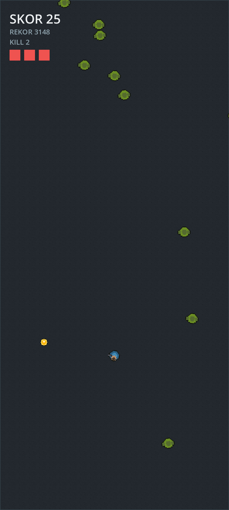

# MyFirstSimpleGame

Game mobile 2D *endless survival* bertema zombie (judul kerja internal: *BERTAHAN*). Geser satu jari untuk bergerak — pistol menembak
sendiri ke zombie terdekat. Bertahan selama mungkin, kumpulkan skor, pecahkan rekormu.



Dibuat dengan **Godot 4.7.2** (renderer Compatibility), target Android portrait 9:16.

---

## Tentang game

| | |
|---|---|
| **Genre** | Endless arena survival |
| **Kontrol** | Drag 1:1 di mana saja (satu tangan), auto-aim + auto-fire |
| **Ikon** | 512×512 + adaptive foreground/background 432×432 (dibuat `tools/gen_assets.py`) |
| **Loop** | Geser → tembak zombie → ambil koin/medkit → naik level senjata → mati → ulang |
| **Skor** | kill × nilai (10/15/40) + bonus koin + detik bertahan |
| **Rekor** | tersimpan lokal di `user://save.cfg` |

**Zombie:** walker (lambat, 1 HP) · runner (cepat, muncul setelah 45 s) · brute (6 HP, muncul setelah 90 s).
HP zombie naik seiring waktu, dan horde 10 zombie menyerbu tiap 75 detik dengan tanda panah merah.

**Upgrade dalam satu run:** setiap naik level, permainan berhenti dan muncul **3 kartu acak** —
pilih satu (Tembak Cepat, Peluru Ganda, Peluru Tembus, Kaki Ringan, Darah Tebal, Magnet, Peluru Besar,
Bidik Jauh). Ambang level: 8 kill pertama, lalu `kill + 6 + level×2`. Pola ini mengikuti Brotato
(4 pilihan per level, bertingkat) dan Vampire Survivors/Archero (pause → pilih 1 dari beberapa kartu).

## Status

Proyek berada di **iterasi I3**: kartu upgrade acak dan ikon 512/adaptive sudah masuk, APK debug
teruji di emulator.
Yang **belum**: tes di HP fisik, tuning kurva akhir, tutorial, toggle efek darah, ikon adaptif,
dan signing rilis. Detail ada di [docs/devlog-i2.md](docs/devlog-i2.md).

## Menjalankan

Butuh **Godot 4.7.2** (atau 4.7.x). Buka folder ini lewat Godot Project Manager, atau dari CLI:

```bash
godot --path . --editor    # buka editor
godot --path .             # langsung mainkan
```

## Build APK

Butuh JDK 17 + Android SDK (build-tools 36.1.0, platform android-36). Preset ekspor ada di
`export_presets.cfg` (tipe Android, arm64-v8a + x86_64, package `com.example.myfirstsimplegame`).

```bash
godot --headless --path . --import          # wajib sekali setelah menambah aset
godot --headless --path . --export-debug "Android" build/MyFirstSimpleGame.apk
```

> Ganti `package/unique_name` di `export_presets.cfg` sebelum publikasi.

## Struktur

```
assets/
  sprites/        8 sprite pixel art + tile lantai (hasil generate)
  sfx/            6 efek suara (hasil generate)
scenes/           main, player, zombie, bullet, pickup (.tscn)
scripts/          game (director), player, zombie, bullet, pickup, hud
tools/
  gen_assets.py   generator pixel art + SFX (tanpa library eksternal)
docs/             GDD, devlog, screenshot
```

## Aset

Semua gambar dan suara **dibuat prosedural** oleh `tools/gen_assets.py` — tidak ada aset pihak ketiga,
tidak ada masalah lisensi. Ubah palet/bentuk lalu jalankan:

```bash
python3 tools/gen_assets.py
```

## Desain

- [GDD ringkas](docs/GDD.md) — loop, kontrol, skor, kurva kesulitan, rencana iterasi
- [Devlog I1](docs/devlog-i1.md) — grey box, tuning pertama
- [Devlog I2](docs/devlog-i2.md) — art, tipe zombie, pickup, upgrade, bug yang ditemukan

## Spesifikasi teknis

- Godot 4.7.2, renderer **Compatibility** (OpenGL 3.3) untuk kompatibilitas HP lama
- Viewport 720×1280, stretch `canvas_items` / `expand`, portrait
- Maksimum 55 zombie + 60 peluru di layar; separation O(n²) sederhana
- Semua balancing di `scripts/game.gd` (interval spawn, HP scaling, tabel upgrade)

## Lisensi

Belum ditentukan. Tambahkan `LICENSE` sebelum repo dipublikasikan.
